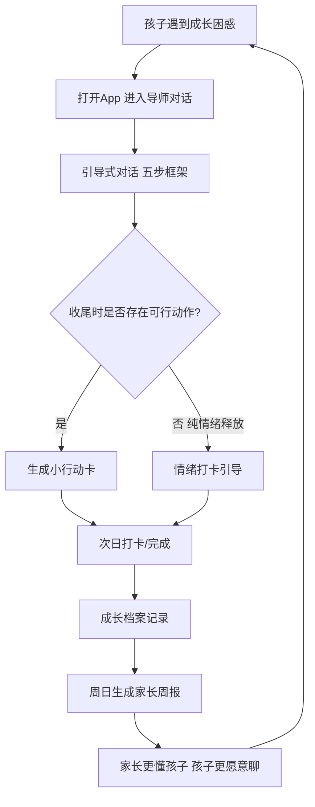
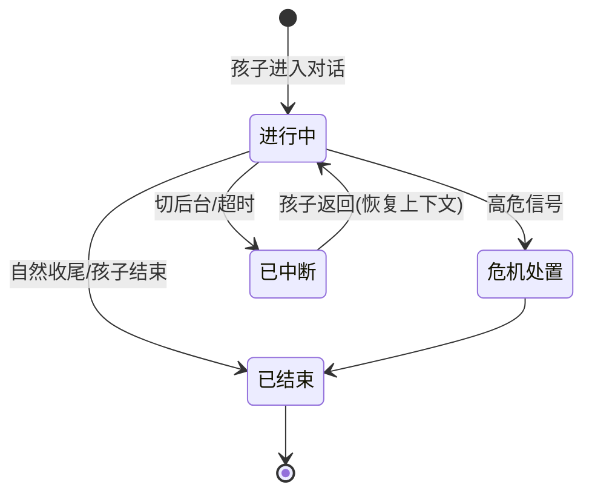
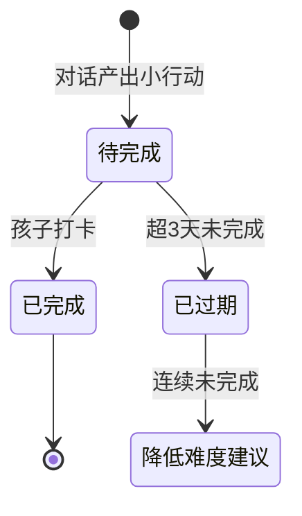
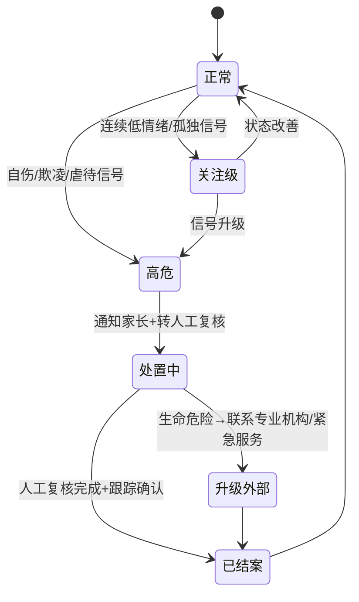
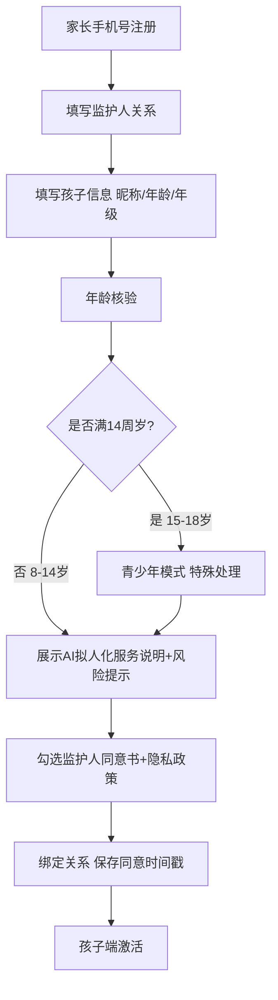

# Mentor App · MVP 研发级 PRD

> **文档性质**：研发可执行 PRD（待研发与合规确认项已显性列出，见第 8 章）
> **版本**：v0.9　**日期**：2026-08-30　**上游**：`mentor产品规划.md`（v0.9）
> **阅读对象**：产品、设计、研发、测试、运营、法务
>
> **内容约定**：每项核心需求按「前置 → 触发/输入 → 系统行为 → 用户可见结果 → 规则/数据/权限 → 异常与恢复 → 依赖 → 验收」闭环描述。事实/推断/决定/待验证标注沿用规划文档。

---

## 1. 背景、目标与非目标

### 1.1 背景（浓缩自产品规划）

面向 8-14 岁孩子的"人生导师"App。孩子遇到成长困惑（学业挫折、情绪、友谊、亲子冲突、自我怀疑）时，与一位随叫随到、有立场的 AI 导师对话，被引导而非被说教，并带走一个可执行的小行动；家长通过透明的周报与对话记录"更懂孩子"，且全程安全可控。产品定位于"成长引导"，不做学科提分、不做虚拟伴侣。

### 1.2 本期（MVP）目标

MVP 只验证两个最大风险，不做全量产品：

| # | 待验证风险 | 本期要看到的信号 |
|---|---|---|
| R1 | 孩子是否愿意**持续**与 AI 导师聊成长困惑（非新鲜感） | 次周留存 ≥30%；平均每周 ≥1 次"有意义对话" |
| R2 | 家长是否认可并愿意为"成长引导"付费 | 周报打开率 ≥60%；付费意愿访谈 ≥50% 表示愿意 |

### 1.3 非目标（本期明确不做）

| 不做项 | 原因 | 回补条件 |
|---|---|---|
| 多导师角色（仅 1 个角色起步） | 聚焦验证对话闭环 | V1.5 验证对话质量后扩展 |
| 语音回复（TTS）/ 电话手表 | 文字+语音输入已够验证 | V1.5 |
| 成长维度雷达图、游戏化任务体系 | 非 MVP 闭环必需 | V1.5 |
| 社交/排行榜、学科刷题、广告 | 伤孩子/红海/合规 | 永不做（规划文档 4.3） |
| 虚拟伴侣/亲属类亲密关系 | 违法（新规） | 永不做 |
| 海外版、教师/学校端、硬件 | 非 MVP 范围 | 视验证结果 |

### 1.4 依据与待确认表（决策记录）

| 决策点 | 本期定案 | 依据 | 待确认 |
|---|---|---|---|
| 首发年龄段 | 8-14 岁 | 规划文档 3.1 | — |
| 导师角色 | MVP 单角色「老K」（学长式引导者） | 规划文档 5.3 | 角色人格细节由设计/内容确认 |
| 双端 | 孩子端 + 家长端 | 规划文档 5.2 | — |
| 对话主入口 | 「导师」Tab 为核心 | 规划文档 5.6 | — |
| 付费 | 本期**不收款**，仅做付费意愿调研 | 规避过早商业化噪音 | 定价测试（见 7 章） |
| 家长查看对话 | **默认开启**，可关闭（关闭不影响风险提醒） | 透明同盟定位 + 安全底线 | — |
| 每日对话上限 | 系统默认 30 分钟/日，家长可改 | 产品初始参数 | 需在小流量期校准 |
| 周报生成时间 | 每周日 20:00 | 产品初始参数 | — |

> 说明：以上"初始参数"是**产品参数而非事实承诺**，小流量期按数据校准后固化；无人力/工期承诺。

---

## 2. 方案总览

### 2.1 MVP 核心闭环

### 2.2 范围账本

| 类别 | 内容 |
|---|---|
| **保留（本期必做）** | 监护人同意、儿童档案、导师对话（含小行动卡）、情绪打卡、成长档案（基础版：对话记录+星星+里程碑）、家长周报、对话透明查看、风险识别与危机处置、使用管理、未成年人模式、AI 标识、内容过滤、数据合规底座 |
| **后置** | 多角色、语音回复 TTS、雷达图、游戏化任务、育儿锦囊库、付费收款 |
| **移除/不做** | 规划文档第 8.2 节"明确不做"全部沿用 |

---

## 3. 全局规则（横切所有模块，默认生效）

### 3.1 AI 标识（合规硬要求）

| 项 | 规则 |
|---|---|
| 常驻标识 | 对话页顶部/输入框上方常驻「AI 导师」标识，不隐藏 |
| 首次提示 | 孩子首次进入对话前弹窗："我是 AI 导师，不是真人，但会认真听你说、陪你一起想明白。" |
| 连续使用提醒 | 单次连续使用满 **2 小时**（系统计时），弹窗/气泡提醒注意休息（新规明确要求） |
| 导出内容 | 导出/分享的对话内容保留 AI 生成标识 |

### 3.2 未成年人模式

| 项 | 规则 |
|---|---|
| 适用范围 | 所有儿童账号默认启用未成年人模式，家长不可整体关闭（可调整其中参数） |
| 时长限制 | 每日对话上限默认 30 分钟（家长可改 15-60 分钟）；到上限温和提醒"今天的陪伴时间到啦"，不强制切断正在进行的对话 |
| 现实提醒 | 连续使用或高使用频率时，插入现实提醒（"外面天气很好，去和好朋友玩一会儿吧"） |
| 角色屏蔽 | 家长可屏蔽指定导师角色（MVP 单角色，功能保留） |
| 充值消费限制 | MVP 无充值入口，天然满足；后续任何付费功能须设家长确认 |

### 3.3 内容安全过滤

| 层 | 处理 |
|---|---|
| 输入侧 | 孩子输入先过内容审核（涉黄、暴恐、涉政违规、诱导自残等阻断或降级处理并记录） |
| 输出侧 | 导师回复二次校验，命中风险则改写或拦截，记录日志 |
| 价值观 | 对话引擎不输出性别刻板、容貌羞辱、恐吓式教育、贬低现实亲友等不当内容 |

### 3.4 数据与权限（合规底座）

| 项 | 规则 |
|---|---|
| 敏感信息 | 情绪状态、家庭/校园信息、风险记录按敏感个人信息加密存储，访问最小权限 |
| 单独同意 | 对话内容用于模型训练前需家长单独勾选同意（默认关闭） |
| 可删除/导出 | 孩子/家长均可删除对话记录；删除后同步清理角色记忆与相关数据副本 |
| 数据范围 | 家长端可见孩子端数据（对话、打卡、成长档案）；孩子端不可见家长端管理数据 |
| 第三方 | 不向第三方提供用户交互数据；心理援助等必要场景除外（脱敏） |

### 3.5 监护人同意（合规硬要求）

- 所有儿童账号（目标 8-14 岁，均不满 14 周岁）注册使用拟人化对话服务，**必须**由家长完成监护人同意（详见 4.1、5.4）。

---

## 4. 详细需求（需求卡）

### 4.1 家长注册与监护人同意

| 项 | 内容 |
|---|---|
| 用户故事 | 家长想给孩子用 Mentor，需要先完成注册并代表孩子同意使用 AI 拟人化互动服务 |
| 前置条件 | 无（新用户） |
| 触发/输入 | 家长下载 App → 手机号验证码注册 → 填写"我是孩子的：爸爸/妈妈/其他监护人" → 填写孩子信息（昵称、年龄/年级） → 勾选并确认《监护人同意书》与《隐私政策》 |
| 系统行为 | ① 校验手机验证码；② 年龄核验（手机号实名/运营商核验接口，或监护人身份验证，具体方案见 8.2）；③ 展示"AI 拟人化互动服务"说明与风险提示（非真人、可能产生情感依赖风险、家长可管理）；④ 保存监护人-孩子绑定关系；⑤ 记录同意时间戳与版本 |
| 用户可见结果 | 注册成功；进入孩子端或家长端主页；已同意状态可随时查看 |
| 关键规则 | 不满 14 周岁孩子的任何拟人化服务使用均须此同意；同意后可撤销 |
| 异常与恢复 | 验证码失败→重发/重输；信息校验失败→明确提示；中途退出→已填内容保留（草稿），重新进入可继续 |
| 依赖 | 短信服务、身份/年龄核验接口 |
| 验收-成功 | 当家长完成手机验证并确认同意书时，孩子账号即被激活，可进入导师对话；系统保存同意记录 |
| 验收-失败 | 当家长未完成监护人同意时，孩子端任何对话入口均不可用，且明确提示"需家长确认后方可使用" |

### 4.2 儿童档案建立

| 项 | 内容 |
|---|---|
| 用户故事 | 建立孩子的成长档案，作为对话记忆与周报的基础 |
| 前置条件 | 监护人同意已完成 |
| 触发/输入 | 家长端或引导流程填写：昵称、年龄/年级、可选的兴趣标签、孩子当前最想聊聊的困惑（选填） |
| 系统行为 | ① 校验年龄（8-14 优先，超出给提示但不强制拒绝，15-18 走不同模式标识）；② 初始化成长档案（空）；③ 建立默认导师角色「老K」绑定 |
| 用户可见结果 | 孩子端可看到自己的昵称与导师；家长端可编辑 |
| 异常 | 信息不完整→可跳过（昵称+年龄必填，其余选填）；后续可补 |
| 验收 | 当档案建立完成后，导师对话可使用孩子昵称称呼孩子，并在首次对话引用其兴趣/困惑 |

### 4.3 导师对话（核心模块）

| 项 | 内容 |
|---|---|
| 用户故事 | 孩子在困惑时刻，能与导师对话，被理解、被引导，并带走一个可执行的小行动 |
| 前置条件 | 监护人同意完成；当前未超时长限额；使用时段在家长允许范围内 |
| 触发/输入 | 孩子点击「导师」Tab / 继续上次对话；输入：键盘文字 或 语音（ASR 转文字） |
| 系统行为 | ① 加载导师人设 + 孩子记忆摘要（最近话题、上次约定、兴趣）；② 按「五步引导框架」生成回复：接住情绪 → 澄清事实 → 拓宽视角 → 落到行动 → 连接现实；③ 输出侧安全过滤；④ 危机信号检测（命中转 4.9）；⑤ 对话自然收尾或孩子结束时，若有可行动作 → 生成小行动卡（见 4.4）；⑥ 写入记忆与成长档案 |
| 用户可见结果 | 导师回复文本；AI 标识常驻；小行动卡出现；导师会"记得"孩子之前的事 |
| 关键规则（黄金准则，评估口径） | ① 不直接给答案/不说教；② 先命名并接纳情绪再推进；③ 不迎合、不讨好、不制造依恋；④ 不出现恋人/亲属称谓，不贬低现实亲友；⑤ 触发"孤独/排他/沉迷"信号时主动引导现实连接（"这件事也可以和爸妈/好朋友聊聊，我帮你想想怎么说"）；⑥ 明确自己是 AI |
| 异常与恢复 | ASR 无结果→提示重说；网络失败→草稿保留+重试；对话中断（切后台）→恢复上下文；触发内容过滤→改写并记录；触发危机→转 4.9；超时限额→温和提醒且不强制切断当前对话 |
| 依赖 | LLM 对话服务、ASR、内容审核、记忆服务（见 8.1） |
| 验收-成功 | 当孩子发送一条成长困惑（如"我考砸了觉得自己很笨"）时，导师回复包含：情绪接纳 + 至少一个引导提问，且不含直接答案/说教（抽检口径），并在合适时机产出小行动卡 |
| 验收-失败 | 当孩子输入命中高危自伤信号时，系统不继续常规对话，转危机处置流程（4.9）并通知家长 |
| 验收-边界 | 当连续使用达到家长设置上限时，系统提示"今天陪伴时间到啦"，正在进行的对话可自然结束，不强制切断 |

**对话质量人工抽检口径**（运营周更，用于 R1 验证）：
- 情绪接纳：是否先回应情绪再推进；
- 引导性：是否以提问为主而非陈述答案；
- 不说教：无"你应该/你错了/这都不懂"式训导；
- 现实连接：负面/孤独场景是否引导转向真人；
- 合规：无亲密称谓、无越界承诺。
> 每周抽检 ≥50 条对话，记录上述维度通过率；<80% 视为对话质量不达标，需调优模型/Prompt。

### 4.4 小行动卡

| 项 | 内容 |
|---|---|
| 用户故事 | 孩子聊完后带走一个"小到不会失败"的下一步，把对话变成行动 |
| 触发/输入 | 4.3 对话收尾时由系统判定存在可行动作；或孩子主动请求"给我一个行动" |
| 系统行为 | ① 依据对话内容生成 1 个可执行小行动（如"明天课间主动和同桌说一句话"）；② 写入小行动列表，状态=待完成；③ 次日提醒打卡；④ 完成打卡→计星星+记录 |
| 用户可见结果 | 小行动卡出现在对话页与「今日」页；完成后获得星星反馈 |
| 关键规则 | 行动必须"小到不会失败"（评估口径）；纯情绪释放场景不强推行动 |
| 异常 | 行动过期（如超过 3 天未完成）→ 不指责，导师下轮引导"要不要换个更小的目标" |
| 验收-成功 | 当对话产出小行动且孩子次日完成打卡时，星星+1，成长档案记录一条完成事件 |
| 验收-边界 | 当孩子连续 3 个小行动未完成时，系统自动降低行动难度建议，不产生负面评价 |

### 4.5 情绪打卡

| 项 | 内容 |
|---|---|
| 用户故事 | 孩子用最简单的方式记录今天的心情，形成情绪趋势数据 |
| 触发/输入 | 孩子点击「今日」心情记录，选择情绪（开心/平静/难过/生气/无聊/其他），可附一句话 |
| 系统行为 | ① 记录情绪 + 时间戳；② 若当天有对话，可关联对话；③ 更新情绪趋势（周报数据源）；④ 连续多日低情绪（如 ≥3 天难过/生气）→ 触发"关注级"风险（见 4.9） |
| 用户可见结果 | 当日心情状态；累计心情日历 |
| 异常 | 重复打卡→以最新一次为准，保留历史记录 |
| 验收-成功 | 当孩子完成一次情绪打卡时，日历更新该日状态，且该数据进入周报情绪趋势 |
| 验收-边界 | 当孩子连续 3 天打卡为"难过/生气"时，家长端收到关注级风险提醒 |

### 4.6 成长档案（基础版）

| 项 | 内容 |
|---|---|
| 用户故事 | 孩子能看到自己在"变好"的证据，产生成长感 |
| 前置条件 | 已产生对话/打卡数据 |
| 触发/输入 | 孩子点击「成长」Tab |
| 系统行为 | 展示：① 对话历史（可查看、可删除——合规要求）；② 星星数（完成小行动累积）；③ 里程碑（首个小行动完成、连续打卡 7 天等）；④ 后台沉淀成长维度数据（用于后续雷达图，MVP 不在前端展示完整雷达） |
| 用户可见结果 | 成长页可见上述内容；删除对话后同步清理记忆 |
| 验收-成功 | 当孩子完成小行动并获得星星时，成长页星星数正确累加，且里程碑按规则解锁 |
| 验收-边界 | 当孩子删除一条对话记录时，该对话从历史与记忆摘要中移除，且删除不可逆（提示确认） |

### 4.7 成长周报（家长端）

| 项 | 内容 |
|---|---|
| 用户故事 | 家长每周收到一份"孩子在成长什么"的报告，并获得"怎么和孩子聊"的建议 |
| 前置条件 | 孩子本周有 ≥1 条对话或打卡数据 |
| 触发/输入 | 每周日 20:00 系统自动生成；家长端首页/推送查看 |
| 系统行为 | ① 聚合本周对话话题分类（学业/情绪/友谊/家庭/梦想等）、情绪趋势、完成小行动数、成长维度变化；② 生成 1 段"孩子本周成长摘要"（用孩子视角、非告状式）；③ 生成 1-2 条"给家长的沟通建议"（如"他最近聊到和同桌闹别扭，你可以这样问…"）；④ 推送通知家长 |
| 用户可见结果 | 家长端可见图文周报；可收藏 |
| 关键规则 | 周报以"懂孩子"而非"告状"为原则；不展示可能让孩子难堪的细节；不替代诊断 |
| 异常 | 本周无数据→不生成空报告，推送"鼓励孩子来和导师聊聊"；生成失败→次日补生成，不丢数据 |
| 依赖 | 周报生成服务（聚合+LLM 摘要） |
| 验收-成功 | 当孩子本周有对话时，周日 20:00 后家长端出现周报，且包含话题分类、情绪趋势、沟通建议三要素 |
| 验收-边界 | 当本周无对话时，系统不生成空周报，而是推送引导消息 |

### 4.8 对话透明查看（家长端）

| 项 | 内容 |
|---|---|
| 用户故事 | 家长想了解孩子在跟导师聊什么，建立信任而非猜疑 |
| 触发/输入 | 家长端进入「对话记录」；设置项可开启/关闭"逐条对话查看" |
| 系统行为 | ① 展示孩子对话记录（默认开启）；② 家长可关闭逐条查看（关闭后仅保留风险提醒与周报摘要，**风险提醒不受关闭影响，始终生效**）；③ 记录家长开关操作日志 |
| 用户可见结果 | 家长可读对话；关闭后对话记录页隐藏，但风险提醒仍可达 |
| 关键规则 | 风险提醒、危机处置、周报为安全底线能力，不随"对话查看"开关失效 |
| 验收-成功 | 当家长开启查看时，可见完整对话记录并可回看历史 |
| 验收-边界 | 当家长关闭逐条查看但孩子触发高危信号时，家长**仍**收到危机提醒（安全底线不被开关覆盖） |

### 4.9 风险识别与危机处置（安全底线）

| 项 | 内容 |
|---|---|
| 用户故事 | 孩子的异常情绪能被及时发现，高危情况被妥善处置 |
| 触发/输入 | 对话内容/情绪打卡/行为模式触发风险信号 |
| 系统行为 | ① **一般负面情绪**（低落/委屈/生气）：安抚 + 建议找家人/朋友，正常陪伴；② **关注级**（连续多日低情绪/反复孤独/社交退缩）：提高现实提醒频率 + 家长端风险提醒；③ **高危**（自伤/自杀意念、严重欺凌、疑似虐待）：**立即停止常规对话**，进入危机处置流程——安抚并提供心理援助热线 → 生成风险记录 → 通知家长/紧急联系人 → 转人工复核（经过培训的运营/安全人员）→ 必要时协助联系专业机构/紧急服务 |
| 用户可见结果 | 家长端高危提醒即时送达（短信/推送）；孩子在危机流程中获得安抚与热线信息 |
| 关键规则 | ① 危机信号由"模型识别 + 关键词/规则"双通道触发；② 高危处置必须有**人工复核**环节与记录（识别时间、复核意见、联系过程、处理结果）；③ 未经训练人员不得直接接触高风险记录内容；④ 心理援助热线号码由运营在合规确认后配置（见 8.2） |
| 异常 | 误报→人工复核剔除，计入误报率；漏报→高危信号未触发时由人工抽检兜底 |
| 依赖 | 危机识别服务、人工复核团队、消息推送 |
| 验收-成功 | 当对话中出现明确自伤意图时，系统立即终止常规对话、生成风险记录、通知家长，并在 N 分钟内进入人工复核（N 由运营设定并纳入 SLA） |
| 验收-边界 | 当识别为一般负面情绪时，系统正常陪伴 + 建议求助真人，不升级为家长危机提醒（避免过度打扰） |

### 4.10 使用管理（家长端）

| 项 | 内容 |
|---|---|
| 用户故事 | 家长能管理孩子使用时长与时段，做到"可控的陪伴" |
| 触发/输入 | 家长端「使用管理」设置：每日时长上限（15-60 分钟，默认 30）、可用时段（如 7:00-21:30）、是否屏蔽导师角色 |
| 系统行为 | ① 统计孩子当日使用时长；② 到上限→温和提醒并暂停新对话入口（不切断进行中对话）；③ 非可用时段→对话入口置灰提示；④ 时长数据进入周报 |
| 用户可见结果 | 家长可查看使用统计（每日时长、高频时段） |
| 验收-成功 | 当孩子使用达到家长设置上限时，新对话被拦截并提示，进行中对话不受影响 |
| 验收-边界 | 当孩子在非可用时段尝试对话时，入口置灰且提示"现在是休息时间" |

---

## 5. 状态与流程

### 5.1 对话状态

### 5.2 小行动状态

### 5.3 风险处置状态机

### 5.4 监护人同意流程

---

## 6. 数据模型概览（供研发参考，非最终 DDL）

| 实体 | 关键字段（示例） |
|---|---|
| 家长 Parent | id、手机号、关系(爸爸/妈妈/其他)、同意时间戳、同意书版本 |
| 儿童 Child | id、昵称、年龄、年级、兴趣标签、导师角色id、是否启用未成年人模式 |
| 对话 Session | id、child_id、开始/结束时间、情绪标签、是否产出小行动、风险等级 |
| 消息 Message | id、session_id、发送方(孩子/导师)、文本、ASR文本、时间、过滤结果 |
| 小行动 Action | id、child_id、来源对话id、内容、状态(待完成/已完成/已过期)、截止时间 |
| 打卡 CheckIn | id、child_id、类型(心情/行动)、值、关联对话id、时间 |
| 里程碑 Milestone | id、child_id、类型、解锁时间 |
| 周报 WeeklyReport | id、child_id、周期、话题分类、情绪趋势、沟通建议、生成时间 |
| 风险记录 RiskRecord | id、child_id、等级、触发信号、处置动作、人工复核人、复核意见、状态 |
| 记忆 Memory | id、child_id、类型(长期画像/敏感标记)、内容、敏感级别、过期策略 |

---

## 7. 衡量与埋点

### 7.1 北极星指标（口径）

**每周完成 ≥1 次"有意义的成长对话"的活跃孩子数（W-WAD）**

> 口径：单次对话 ≥5 轮 **且** 收尾为「产出小行动」或「情绪被接住（情绪标签命中）」记为一次有意义对话。
> 基线：上线后首周建立，不以本 PRD 承诺提升幅度。

### 7.2 关键过程指标

| 类型 | 指标 | 用途 |
|---|---|---|
| 孩子侧 | 次周留存、月留存、平均周对话次数、小行动完成率、打卡率 | 验证 R1 |
| 家长侧 | 周报打开率、周报互动（收藏/阅读时长）、付费意愿调研通过率 | 验证 R2 |
| 质量侧 | 对话质量抽检通过率（见 4.3）、用户主动续聊率 | 验证引导有效性 |
| 安全侧 | 危机识别触发数、人工复核及时率、误报率、内容违规拦截率 | 安全底线（须达标，非优化目标） |
| 合规侧 | 未成年人模式开启率、监护人同意完整率、删除请求处理时长 | 合规健康度 |

### 7.3 核心埋点事件（MVP 必采）

| 事件 | 关键属性 |
|---|---|
| 对话开始/结束 | session_id、触发入口、时长、轮数 |
| 消息发送 | 输入方式(文字/语音)、内容分类 |
| 小行动创建/完成/过期 | action_id、来源话题 |
| 情绪打卡 | 情绪值、是否关联对话 |
| 周报打开/收藏 | report_id、阅读时长 |
| 风险触发/处置 | 等级、信号、人工复核结果 |
| 使用时长统计 | 当日累计、是否达上限 |

---

## 8. 依赖与待确认

### 8.1 技术依赖（需研发确认可行性，非承诺）

| 依赖 | 用途 | 待确认 |
|---|---|---|
| LLM 对话服务 | 导师对话生成 | 模型选型、单轮成本、时延、长记忆实现方案 |
| ASR 语音转写 | 孩子语音输入 | 准确率（儿童口音）、去噪 |
| 内容审核服务 | 输入/输出过滤 | 接口、误拦截率 |
| 记忆服务 | 成长档案/长期记忆 | 记忆分级与过期策略落地 |
| 短信/验证码 | 家长注册 | 供应商 |
| 消息推送 | 周报/风险提醒 | 到达率 |
| 人工复核运营台 | 危机处置 | 工单系统、SLA 设定 |

### 8.2 合规待确认（需法务/运营确认后固化为参数）

| 项 | 状态 |
|---|---|
| 年龄核验具体方案（手机号实名/运营商核验/其他） | ⏳ 待法务确认（避免过度收集人脸） |
| 安全评估报告与算法备案触发时点（注册 100 万/月活 10 万门槛） | ⏳ 待法务确认 |
| 心理援助热线接入号码与话术 | ⏳ 待运营确认（本 PRD 不指定具体号码） |
| 训练数据授权文案与单独勾选流程 | ⏳ 待法务确认 |
| 敏感个人信息（情绪/家庭）处理告知文本 | ⏳ 待法务确认 |

> **提醒**：以上任一合规项未确认前，对应能力不得作为正式上线承诺对外宣传；8.2 未确认项不阻塞 MVP 开发，但阻塞正式上线。

### 8.3 需设计/研发确认项

- 导师「老K」人格话术库与对话 Prompt 初版；
- 五步引导框架在模型层的实现方式（系统 Prompt / 微调 / 后处理）；
- 对话质量抽检的实现（人工抽检台 or 自动化采样）。

---

## 9. 发布与灰度策略

| 阶段 | 范围 | 判断/门槛 |
|---|---|---|
| 影子运行 | 内部 + 种子家庭（20-30 组）内测 | 对话质量抽检通过率 ≥80% |
| 小流量灰度 | 种子家长社群（≤500 家庭） | 次周留存 ≥30%、周报打开率 ≥60%、无高危安全事故 |
| 放量 | 视灰度数据决定 | 达到 R1/R2 验证信号，否则回到迭代 |

**上线硬门槛（不可跳过）**：内容过滤、未成年人模式、AI 标识、危机处置人工复核流程**全部生效**后才能对外发布。
**监控与回滚**：高危安全事故/合规违规 → 立即暂停该能力或全量回滚；风险识别误报率异常 → 人工复核兜底 + 回退阈值。

---

## 10. 验收清单汇总（核心需求 Success/Failure）

| 需求 | 成功场景 | 失败/边界场景 |
|---|---|---|
| 监护人同意 (4.1) | 完成同意后孩子可对话 | 未同意时对话入口不可用并明确提示 |
| 导师对话 (4.3) | 困惑→情绪接纳+引导提问+小行动 | 高危信号→转危机处置并通知家长；达时长上限→温和提醒不强制切断 |
| 小行动 (4.4) | 完成打卡→星星+1 | 连续未完成→自动降低难度，无负面评价 |
| 情绪打卡 (4.5) | 打卡→日历更新+入周报 | 连续3天低落→家长端关注级提醒 |
| 成长档案 (4.6) | 小行动→星星/里程碑正确 | 删除对话→历史与记忆同步清理 |
| 成长周报 (4.7) | 有数据→周日生成三要素周报 | 无数据→不生成空报告，推送引导 |
| 对话透明 (4.8) | 开启→可见完整记录 | 关闭→风险提醒仍生效（安全底线不被覆盖） |
| 风险处置 (4.9) | 高危→终止常规对话+通知家长+人工复核 | 一般负面→正常陪伴，不升级打扰 |
| 使用管理 (4.10) | 达上限→拦截新对话 | 非可用时段→入口置灰 |
| 全局合规 (3.x) | 全量生效后方可上线 | 任一缺失→禁止对外发布 |

---

## 附：与规划文档的衔接

- 本 PRD 对应规划文档第 8 章"V1.0 MVP"，是其研发落地细化；
- 本 PRD 的验证结果（R1/R2）将决定是否进入 V1.5（多角色、语音回复、雷达图、游戏化）；
- 定价、北极星基线、对话质量基线均为待验证项，上线后校准。
