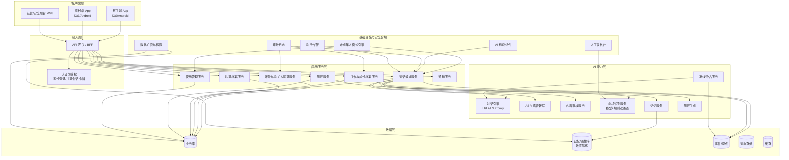
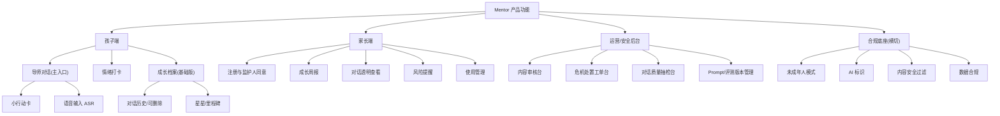
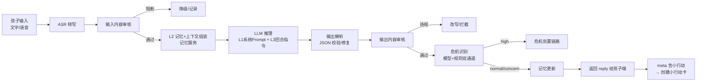
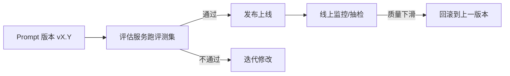
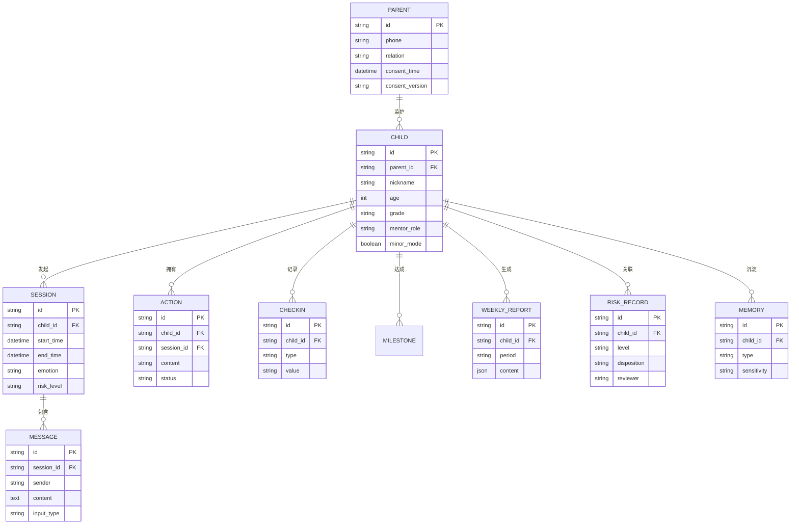
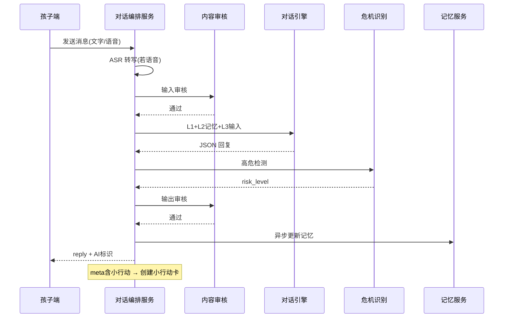
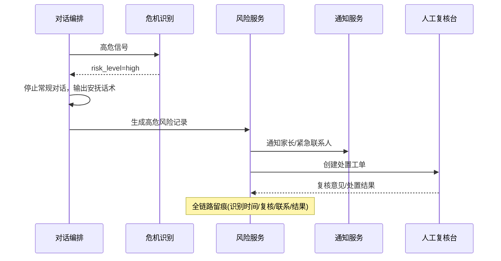
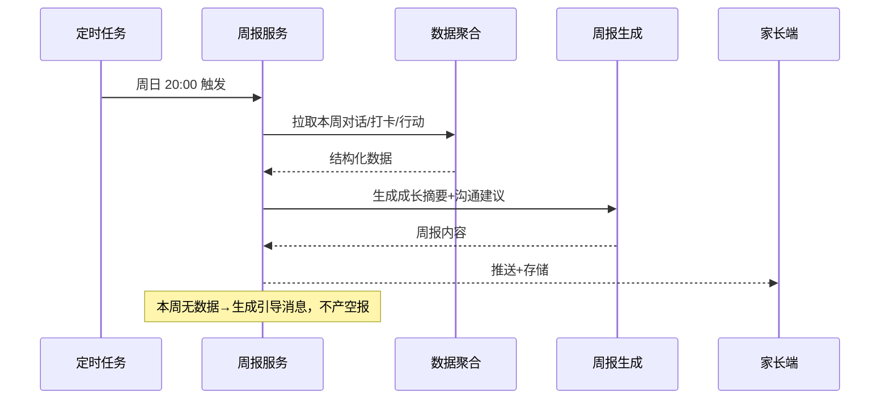

# Mentor 产品架构设计

> **用途**：基于 `mentor_MVP_PRD.md`（v0.9）落地为可评审、可开发的产品架构方案。
> **版本**：v0.1　**日期**：2026-08-30　**上游**：`mentor_MVP_PRD.md`、`mentor_导师对话_Prompt规格.md`
> **阅读对象**：研发（总体架构/服务拆分）、产品（功能架构对齐）、安全合规、测试
>
> **标注约定**：沿用前序文档——【事实】【推断】【决定】为产品/架构决策，【待研发确认】为技术选型开放项（不视为既定承诺）。

---

## 1. 架构设计原则（决定）

| # | 原则 | 落地含义 |
|---|---|---|
| P1 | **安全合规是一等公民，不是附加模块** | 未成年人模式、AI 标识、危机处置、数据保护作为横切能力内建于服务链路，而非事后补丁（PRD 第 3、9 章硬门槛） |
| P2 | **AI 能力可评估、可回滚** | 对话引擎带版本化 Prompt 与评估服务，任何 Prompt/模型变更先过评测集再上线 |
| P3 | **孩子体验优先，家长透明兜底** | 孩子端极简、对话为主入口；家长端价值（周报/风险）由异步服务保障，不阻塞孩子主流程 |
| P4 | **数据最小化与分级保护** | 儿童情绪、家庭等敏感信息单独加密、最小权限、可删除（PRD 3.4） |
| P5 | **双通道安全兜底** | 危机识别 = 模型识别 + 规则/关键词双通道，人工复核兜底（PRD 4.9） |
| P6 | **模块化可替换** | LLM/ASR/审核等外部依赖抽象为接口，避免供应商锁定（规划文档 4.2） |

> 【待研发确认】具体技术栈、中间件、云服务供应商由研发在评审后确定；本文给出职责边界与候选方向，不承诺具体产品。

---

## 2. 总体架构（分层视图）



**分层职责**：

| 层 | 职责 | 关键约束 |
|---|---|---|
| 客户端层 | 双端体验、AI 标识展示、未成年人模式前端配合 | 孩子端不暴露敏感运营信息 |
| 接入层 | 鉴权（家长/儿童会话）、限流、参数校验、未成年人模式判定前置 | 未完成监护人同意 → 对话入口不可达（PRD 4.1 验收） |
| 应用服务层 | 业务闭环：同意/档案/对话编排/打卡/周报/使用管理/通知 | 对话编排是核心协调者 |
| AI 能力层 | 对话、ASR、审核、危机识别、记忆、周报生成、评估 | 全部接口化，可替换 |
| 数据层 | 业务/记忆/埋点/对象/缓存 | 敏感数据物理或逻辑隔离 |
| 底座 | 合规横切能力 | 缺失任一项 → 禁止对外发布（PRD 第 9 章） |

---

## 3. 功能架构

### 3.1 功能模块树



### 3.2 模块依赖关系（关键）

| 模块 | 依赖 | 被依赖 |
|---|---|---|
| 监护人同意 (P1) | 短信、年龄核验 | 所有孩子端入口（硬前置） |
| 对话编排 (K1) | ASR、审核、LLM、危机识别、记忆 | 小行动卡、情绪打卡、成长档案、周报 |
| 风险处置 | 危机识别、通知、人工复核台 | 家长端风险提醒 |
| 周报 | 对话/打卡/行动聚合 + 周报生成 | 家长端周报 |
| 使用管理 | 使用统计 | 对话入口限流 |

---

## 4. 技术架构（服务划分）

### 4.1 服务清单（候选拆分，待研发确认）

| 服务 | 职责 | 关键能力/接口（示例） | 依赖 |
|---|---|---|---|
| 账号与同意服务 | 家长注册、监护人同意、儿童绑定、年龄核验 | `POST /consent`、`GET /consent/status` | 短信、核验服务 |
| 儿童档案服务 | 档案 CRUD、导师角色绑定 | `POST /child`、`GET /child/profile` | — |
| 对话编排服务（核心） | 编排整个对话流水线、状态管理、小行动卡产出 | `POST /chat/send`、`GET /chat/history` | 全部 AI 能力 |
| 打卡与成长档案服务 | 情绪打卡、行动打卡、里程碑、成长档案 | `POST /checkin`、`GET /growth` | — |
| 周报服务 | 定时聚合、周报生成与推送 | 内部 `GenerateWeeklyReport` | 聚合、周报生成 |
| 使用管理服务 | 时长/时段/角色屏蔽、未成年人模式参数 | `GET/PUT /parent/usage` | — |
| 通知服务 | 推送/短信（周报、风险提醒） | `POST /notify` | 推送/短信供应商 |
| 人工复核台 | 危机工单、抽检评分 | Web 后台 | 风险服务 |

> 【待研发确认】服务粒度可按团队规模合并（如 MVP 阶段可单体+模块化起步），本表为逻辑边界而非强制微服务拆分。

### 4.2 通信方式

| 场景 | 方式 | 说明 |
|---|---|---|
| 对话请求 | 同步 HTTP/长连接 | 孩子端发消息 → 等待回复（可带流式） |
| 周报生成 | 异步任务（定时触发） | 周日 20:00，失败补生成 |
| 风险提醒 | 异步（消息队列） | 高危需即时，降级短信兜底 |
| 埋点 | 异步上报 | 不阻塞主流程 |

---

## 5. AI 架构（核心）

### 5.1 对话流水线（导师对话）



**流水线关键点**：
- **输入→输出全链路内容审核**（PRD 3.3），审核不过不进入 LLM 或不外发；
- **危机识别独立于对话**，双通道（模型分类 + 规则/关键词），结果路由到处置链路（PRD 4.9）；
- **结构化 JSON 输出**（Prompt 规格 §2）驱动后续动作：小行动卡创建、风险路由、埋点、评估；
- **记忆更新异步化**：不阻塞孩子看到回复。

### 5.2 记忆服务

| 层 | 内容 | 存储 | 访问权限 | 过期策略 |
|---|---|---|---|---|
| 短期上下文 | 当前/近 8 轮对话 | 会话缓存 | 对话服务 | 会话结束即失效 |
| 长期画像 | 兴趣、话题偏好、成长维度变化 | 记忆库 | 对话服务、周报服务 | 随删除请求清理 |
| 敏感标记 | 情绪低谷、家庭/校园变故 | 隔离存储 | 仅安全链路 | 加密 + 严格访问控制 |

### 5.3 评估服务（闭环）

- **离线评测集**（Prompt 规格 §6.3，12 例起步）→ 每次 Prompt/模型变更自动跑；
- **Rubric 评分**（6 维，总分 ≥80% 且 D5 不为 0）；
- **人工抽检台**：运营每周抽检 ≥50 条真实对话（PRD 4.3）；
- **结果回写**：评分进入版本管理，驱动 Prompt 迭代（Prompt 规格 §7）。

### 5.4 Prompt 版本管理



---

## 6. 数据架构

### 6.1 数据模型关系（PRD 第 6 章落地）



### 6.2 敏感数据分级与保护

| 级别 | 数据 | 措施 |
|---|---|---|
| 高敏感 | 情绪记录、家庭/校园信息、风险记录、原始对话 | 加密存储、最小权限、访问审计、可删除 |
| 一般 | 昵称、年龄、年级、打卡 | 常规保护 |
| 运营 | 埋点（脱敏） | 匿名化 |

### 6.3 删除链路（合规要求，PRD 3.4）

```
用户删除请求 → 业务库删除对话/档案 → 同步清理记忆库相关副本 → 记录删除审计 → 告知完成
```

> 【决定】删除必须跨库联动（业务库 + 记忆库），单库删除视为缺陷（PRD 4.6 验收-边界）。

---

## 7. 安全与合规架构

| 合规能力 | 架构实现 | 验收关联（PRD） |
|---|---|---|
| 未成年人模式 | 接入层前置判定 + 使用管理服务参数下发 + 对话限流 | 3.2 / 4.10 |
| AI 标识 | 客户端组件常驻 + 对话进入提示 + 导出内容标识 | 3.1 |
| 连续 2 小时提醒 | 对话服务计时 → 通知服务 | 3.1 |
| 监护人同意 | 同意服务硬前置，未同意对话入口不可达 | 4.1 |
| 内容过滤 | 输入/输出双审核（AI 能力层） | 3.3 |
| 危机处置 | 危机识别双通道 → 风险服务 → 通知家长 → 人工复核台 → 记录 | 4.9 |
| 数据合规 | 加密/最小权限/审计/删除链路/训练单独授权 | 3.4 |
| 安全评估/备案 | 合规开关 + 审计日志完整留存，达门槛触发评估 | 8.2 待法务确认 |

---

## 8. 部署与灰度架构

| 项 | 方案 | 说明 |
|---|---|---|
| 环境 | 开发 → 预发 → 生产 | 预发跑全量评测集 |
| 灰度 | 影子运行 → 种子家庭（20-30）→ 小流量（≤500）→ 放量 | PRD 第 9 章门槛 |
| 上线硬门槛 | 内容过滤/未成年人模式/AI 标识/危机人工复核全部生效 | 缺失禁止发布 |
| 监控 | 对话质量抽检、危机处置及时率、误报率、异常回退 | 安全指标"须达标" |
| 回滚 | Prompt 版本一键回滚；高危事故暂停对应能力 | P2 原则 |

---

## 9. 关键流程时序

### 9.1 导师对话（一次消息往返）



### 9.2 危机处置（高危分支）



### 9.3 家长周报生成



---

## 10. 关键接口契约（示例，供研发对齐）

### 10.1 对话发送

```
POST /api/v1/chat/send
Header:  Authorization: Bearer <child_token>
Body:    { "input_type": "text|voice", "content": "我考砸了，觉得自己很笨" }
Resp:    {
           "reply": "听起来这次没考好，心里有点难过……",
           "ai_identity": true,
           "action_card": { "content": "今晚弄懂错题里最简单的一道", "status": "pending" } | null,
           "risk_level": "normal",
           "usage_remaining": 18
         }
```

### 10.2 家长周报

```
GET /api/v1/parent/weekly-report?period=2026-W36
Resp: { "topic_tags": ["学业","情绪"], "emotion_trend": [...],
        "action_completed": 3, "summary": "...", "talk_tips": ["..."] }
```

### 10.3 使用管理

```
GET/PUT /api/v1/parent/child/{child_id}/usage
Body: { "daily_limit_min": 30, "allowed_window": "07:00-21:30", "blocked_roles": [] }
```

> 【待研发确认】接口路径、鉴权方案（JWT/会话）、幂等与限流策略由研发评审确定；本表用于对齐职责与字段。

---

## 11. 待确认项汇总

| 类别 | 项 | 责任方 |
|---|---|---|
| 技术选型 | 业务库/记忆库/缓存/队列/对象存储具体产品 | 研发 |
| AI | LLM 模型选型、ASR 供应商、审核服务、成本与延迟预算 | 研发 |
| 架构 | 服务拆分粒度（微服务 or 模块化单体）、长连接方案、JSON 失败兜底 | 研发 |
| 合规 | 年龄核验方案、安全评估/备案触发、心理援助热线号码 | 法务/运营 |
| 内容 | 禁止词表初稿、老K 人格细节 | 内容/安全 |

---

## 附：与前序文档的衔接

- **本架构 = PRD 第 2/4/6/9 章的技术落地方案**；
- **AI 架构 = Prompt 规格的三层架构 + 评估闭环的服务化实现**；
- 架构通过评审后，可据此产出：接口详设、数据表 DDL、前后端任务拆分、测试计划。
