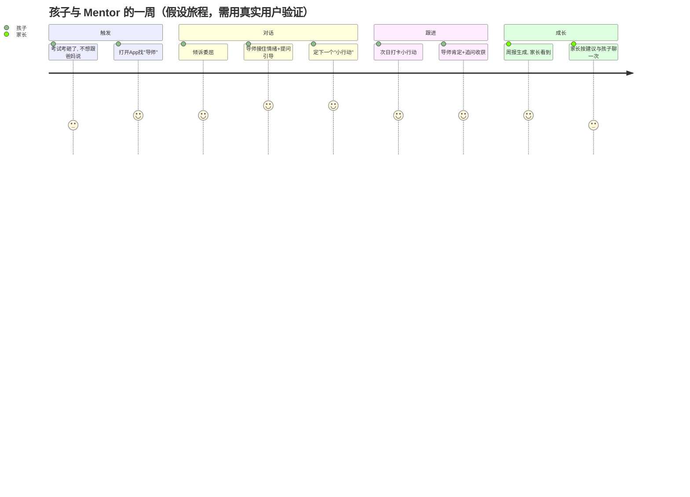
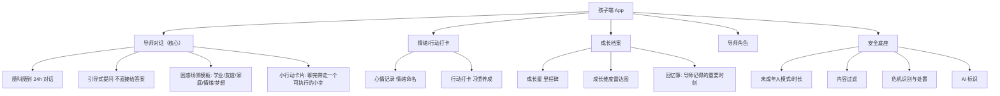
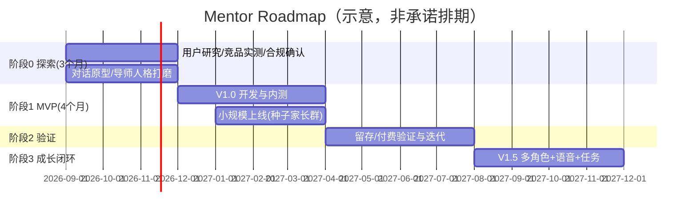

# Mentor App 产品规划

> **一句话定位**：一款面向 8-14 岁孩子的"人生导师"App——孩子遇到成长困惑时，有位懂他、信他、能引导他的 AI 导师随叫随到；家长则在透明的同盟关系中，第一次真正"看见"孩子。
>
> 文档版本：v0.9（规划草案）　日期：2026-08-30　状态：待评审
>
> **事实标注约定**：本文区分四类内容——【事实】有来源支撑；【推断】基于事实的解释，可能有其他原因；【决定】本文主动选择的产品方案；【假设】待验证，不视为已成立。

---

## 0. 一页摘要

| 项 | 内容 |
|---|---|
| 产品愿景 | 每个孩子都拥有一位懂他、信他、能指引他走向现实世界的人生导师 |
| 目标用户 | 孩子 8-14 岁（小学中高年级～初中）+ 其家长（付费者，一线/新一线城市为主） |
| 核心价值 | 孩子端：随叫随到的成长引导（不评判、记得你、帮你成为更好的自己）；家长端：更懂孩子 + 安全可控 |
| 差异化 | 不卷"学科提分"（那是学习机）、不做"虚拟玩伴"（新规禁止+依赖风险），只做**成长引导**：价值观、情绪、社交、习惯、抗挫、自我认知 |
| 关键窗口 | 2026-07-15 五部门 AI 拟人化互动服务新规施行，娱乐化陪伴被禁，合规的"成长导师"定位出现心智空白 |
| 产品形态 | 双端 App：孩子端（导师对话+成长档案）+ 家长端（同意授权+对话透明+成长周报） |
| MVP 核心闭环 | 孩子困惑 → 导师对话引导 → 产出小行动 → 成长档案记录 → 家长收到周报 |
| 商业模式 | 家长订阅制（月/年）+ 深度服务增值；不依赖广告 |
| 北极星指标 | 每周完成 ≥1 次"有意义的成长对话"的孩子数（W-WAD） |

---

## 1. 产品愿景与核心命题

### 1.1 愿景

> **让每一个孩子，在成长的困惑时刻，都有一位可以信赖的引路人。**

现实中，孩子成长路上最稀缺的资源不是题库、不是课程，而是"一个愿意听他说、能把他往正道上引、又不会因为他犯错就否定他的人"。

### 1.2 核心命题（Why Now / Why Us）

```text
孩子成长困惑高频且无助 → 家长有爱但缺方法/没时间 → 通用AI不安全/不管用
        ↓                      ↓                    ↓
  学业压力/情绪/社交/自我怀疑     亲子沟通鸿沟          内容失控/无成长设计
        ↓                      ↓                    ↓
        └──────────┬────────────┴───────────────────┘
                   ↓
    需求：一个"有立场的引导者"，而非"无原则的聊天工具"
```

### 1.3 产品边界（最重要的价值观判断）

**Mentor 不是 Replika，不是猫箱，也不是家教。**

| 角色 | 它做什么 | 它不做什么 |
|---|---|---|
| 虚拟伴侣/玩伴 | 无限顺从、永远迎合、制造依恋 | ❌ 我们不做——新规禁止向未成年人提供虚拟亲密关系，且制造情感依赖 |
| AI 家教 | 答疑、提分、讲题 | ❌ 我们不主打——那是学习机的战场，同质化严重 |
| **人生导师（我们）** | **有立场的接纳**：先共情，再引导孩子面对现实、承担选择、迈出小步 | ✅ 目标是把孩子**推回现实**，而不是留在对话里 |

**导师行为的黄金准则（写入产品，可执行）**：
1. **先接住情绪，再解决问题**（识别情绪 → 命名情绪 → 接纳 → 引导，不跳过情绪直接讲道理）；
2. **不直接给答案，用提问引导孩子自己找到答案**（苏格拉底式）；
3. **永远鼓励现实连接**——当孩子对导师说心事，导师要引导他"这件事也可以和爸妈/好朋友/老师聊聊"，并教他怎么说；
4. **有立场**——该鼓励时鼓励，该指正时温和指正，不迎合、不讨好、不制造依恋；
5. **目标是"让他不再需要我"**——成长的方向永远是独立。

> 【决定】这条黄金准则不是宣传语，而是对话引擎的硬约束（见第 6 章），也是我们与一切"AI 陪伴"产品的根本区别。

---

## 2. 市场与机会

### 2.1 需求侧：问题是否真实存在？（证据充分）

| 数据 | 数值 | 口径与来源 |
|---|---|---|
| 儿童青少年精神障碍总患病率 | **17.5%**（每 6 个孩子约 1 个） | 【事实】2021 年北京安定医院郑毅教授团队《中国青少年精神障碍流行病学调查》（6-16 岁），人民日报健康时报转引 |
| 孩子最大的烦恼来源 | **学业 55.7%** | 【事实】《知心姐姐》"知心调查"面向小学-初中孩子及家长的"当代中国孩子成长烦恼调查"，中国青年网报道 |
| 青少年抑郁检出率 | **24.6%**（2025 年表述） | 【推断/一方称】太原安定医院文章转引，需回源核实原始统计口径 |
| 抑郁风险随学段攀升 | 高中阶段显著高于初中、小学 | 【事实】超 1.1 万名学生的《青少年心理健康白皮书》相关报道，中国青年网 |
| 美国青少年使用过 AI 陪伴机器人 | 72%；33% 与之建立恋爱/友谊关系 | 【事实】共识媒体咨询公司报告，参考消息网/《科学美国人》转引（说明：海外数据，供趋势参考） |
| 青少年对 AI 聊天依赖 | 约 20-30% 的青少年精神科患者对 AI 聊天形成明显依赖 | 【推断/一方称】北京安定医院医生表述，今日头条转引，需回源 |

**痛点到行为（可观察、可验证）**：
- **学业压力**：作业辅导是家庭矛盾高发区（"不写作业母慈子孝，一写作业鸡飞狗跳"是普遍网络共识，非本产品独有观察）；
- **情绪与自我怀疑**：孩子"为什么学习""我是不是很笨""同学都不理我"——这些问题找不到人认真回答；
- **亲子沟通鸿沟**：孩子进入青春期前后越来越不愿跟父母说心里话，家长"想知道但问不出来"；
- **家长无力感**：知道要"引导"却不知道怎么说，讲道理被顶回来，吼完又后悔。

> 【推断】这些痛点指向同一个未满足任务：**孩子需要一个"既有权威感又不会评判他、随叫随到、且家长信任"的成长引导者**。现有替代方案（父母、老师、心理老师、聊天机器人）各自缺一角。

### 2.2 供给侧：为什么是现在

1. **AI 能力拐点已到**【事实】：大模型对话质量、**长期记忆/个性化**、多模态（语音、情绪识别）已足以支撑"记得孩子的成长型对话"，这是两三年前做不到的；
2. **监管划清了边界，反而创造合规窗口**【事实】：2026-07-15 施行的《人工智能拟人化互动服务管理暂行办法》明确"不得向未成年人提供虚拟亲属、虚拟伴侣等虚拟亲密关系服务"，并要求未成年人模式、监护人同意、AI 标识等——**娱乐化陪伴玩家被强制出局或整改，而"成长导师"定位天然合规**，这是历史性窗口；
3. **家长认知已被教育**：豆包、DeepSeek 等在家长中普及了"AI 能辅导孩子"，但同时也暴露了"通用 AI 不适合直接给孩子用"（内容不可控、无儿童安全设计）——市场需要**专门的儿童成长 AI 产品**。

### 2.3 市场空间（有口径，非精确预测）

| 市场 | 规模 | 时间 | 来源/口径 |
|---|---|---|---|
| 国内 AI 玩具市场 | **290 亿元**，2030 预计破千亿，CAGR>20% | 2025 | 【事实】广东省玩具协会测算，人民日报客户端转引 |
| 儿童陪伴 AI 设备市场 | **128.6 亿元**，同比 +23.7% | 2025 | 【事实】博研咨询等机构报告（豆丁网转引，口径为"儿童陪伴AI设备"） |
| 教育智能硬件市场 | **1125 亿元**，同比 +16.94% | 2025 | 【事实】艾媒咨询 |
| AI 陪伴解决方案中"儿童教育陪伴机器人"细分 | **360 亿元**，占 45.3% | 2025 | 【事实】行业报告口径（豆丁网转引，细分口径） |

> 【推断】上述数字口径不同（玩具/设备/硬件），不能简单相加，但共同指向：**"AI 进入儿童成长陪伴"是一个正在放量的千亿级方向**，且增速（20%+）远高于一般消费品。我们切入的是其中的**"成长引导/心智成长"细分**，更精确的 TAM 需要后续按"目标年龄段 × 目标人群 × 付费率"自下而上估算，当前不给出伪精确值。

### 2.4 为什么"人生导师"是空白

- 学科辅导侧：**不缺**（学习机、AI 家教极多，卷提分）；
- 娱乐陪伴侧：**被监管堵死**（猫箱、星野、Character.AI 面向未成年人的亲密陪伴不合规）；
- 情绪安抚侧：**有但浅**（超级球球、圆宝等"AI 玩偶"主打陪伴和哄睡，无成长引导体系、无家长端成长报告）；
- 家长工具侧：**单向**（Zevo 等面向家长的育儿教练，孩子不参与、无对话）；
- 通用 AI：**无儿童安全设计**（家长自制，孩子裸奔）。

> 【推断】"**孩子自己愿意用 + 家长信任付费 + 有成长引导体系 + 全合规**"这四个条件同时满足的产品，目前不存在头部玩家。**这正是"人生导师"的卡位空间。**

---

## 3. 目标用户与核心场景

### 3.1 用户分层

| 角色 | 年龄段 | 角色定位 | 关键诉求 |
|---|---|---|---|
| **孩子（使用者）** | 8-14 岁为核心（小学中高年级～初中） | 成长中的困惑者 | 有人听我说、不评判、给我力量、帮我变好 |
| **家长（购买者）** | 30-45 岁，一二线城市为主 | 教育决策者 | 更懂孩子、减少焦虑、安全可控、确实有效 |
| 次要：教师/心理老师 | — | 后期合作方 | 观察学生成长、辅助干预（后置） |

> 【决定】首发聚焦 8-14 岁：① 该阶段学业压力+青春期前情绪+自我认知需求最突出（数据支撑：10 岁起焦虑抑郁问题增多）；② 家长付费意愿和付费能力最强；③ 6-7 岁语言/理解力偏弱，15-18 岁自主决策强、更难由家长主导购买，均后置。

### 3.2 典型用户画像

**孩子画像（3 类）**：

| 画像 | 描述 | 典型困惑 | 产品切入点 |
|---|---|---|---|
| 「小学高年级的乐乐」10 岁 | 成绩中上，开始有作业压力和同伴比较，情绪波动变多 | "为什么我学不好？""同桌不跟我玩了" | 学业挫折疏导、友谊处理、情绪表达 |
| 「青春前期的默默」12 岁 | 内向，心事多，不愿跟爸妈说，开始在意他人评价 | "我是不是很奇怪？""没人理解我" | 安全倾诉空间、自我认知、社交勇气 |
| 「初中生的航航」14 岁 | 开始叛逆，对学习意义产生怀疑，有目标感萌芽 | "学习到底有什么用？""我想当……" | 目标与生涯启蒙、抗挫、亲子沟通 |

**家长画像（2 类）**：

| 画像 | 描述 | 痛点 | 产品切入 |
|---|---|---|---|
| 「焦虑的辅导型妈妈」 | 工作忙仍事无巨细，辅导作业易失控，怕孩子落后 | 想引导但不会说，怕说错伤孩子 | 成长周报"更懂孩子"+ 对话建议 |
| 「信任的放养型爸爸」 | 认可孩子自主，但担心孩子走弯路、接触不良内容 | 想知道孩子状态但孩子不说 | 透明对话 + 风险预警 |

### 3.3 核心场景与用户任务（JTBD）

| 触发场景 | 孩子想完成的任务 | 现状替代 | 失败成本 |
|---|---|---|---|
| 作业/考试受挫，觉得自己笨 | 有人告诉我"我不是不行"并带我走出来 | 爸妈吼/自己憋着 | 习得性无助、厌学 |
| 被同学孤立/吵架 | 有人帮我理清该不该和好、怎么开口 | 憋着/冲动绝交 | 社交退缩、孤独 |
| 和爸妈冲突后 | 有人理解我，并帮我"怎么和爸妈说" | 冷战 | 亲子关系裂痕 |
| 深夜emo/莫名低落 | 有人接住我，不评判 | 刷手机/没人可说 | 情绪淤积、依赖网络 |
| "学习有什么用" | 有人帮我找到意义 | 被说教"为你好" | 动力丧失 |
| 想养成好习惯但坚持不了 | 有人陪我打卡、给我小步目标 | 三分钟热度 | 自我效能感下降 |

### 3.4 典型用户旅程（一周视角，孩子端）



> 【说明】以上为**待验证的假设旅程**（情绪曲线为设计意图，非实测）。真实摩擦点需通过 MVP 期用户访谈与行为数据校准。

---

## 4. 竞争格局与差异化

### 4.1 竞品地图

| 竞品/赛道 | 代表 | 真正为谁解决什么 | 边界（做不到什么） | 与本产品关系 |
|---|---|---|---|---|
| AI 学习机/家教 | 小猿 R1、学而思、讯飞、Khanmigo、豆包爱学 | 学科提分、作业辅导 | 不解决情绪/社交/自我认知/成长动力 | 功能互补，非直接竞争 |
| AI 拟人陪伴（娱乐） | 字节猫箱、MiniMax 星野、筑梦岛、Character.AI、Replika | 情感慰藉、角色扮演 | 面向未成年人已被新规限制；制造依赖 | **被监管排除**，让出心智 |
| AI 情绪陪伴硬件 | 超级球球、圆宝、AI小智、二元魂、火火兔、牛听听 | 低龄陪伴、哄睡、讲故事 | 无成长引导体系、无家长端成长闭环、能力浅 | 部分重叠（情绪），我们在"引导"上更深 |
| 家长育儿工具 | Zevo、YoKID 等 | 给家长育儿方法/托管 | 孩子不参与对话、无孩子端体验 | 互补：我们双端都有 |
| 通用 AI（家长自制） | 豆包、DeepSeek、Kimi | 家长用来辅导/答疑 | 无儿童安全、无成长设计、内容不可控 | 是我们"更专业安全"的对比对象 |

> 【事实说明】以上竞品信息基于 2025-2026 年公开报道与产品形态的概括性判断；具体功能、版本、价格需在正式立项后逐一实测并回源标注日期。

### 4.2 差异化定位

**我们与所有竞品的关系：**

```text
学习机（卷分数）──  ── AI玩伴（卷陪伴）
        \                /
         \    MENTOR    /
          \  （卷成长） /
           ────────────
   家长工具（单向）──  ── 通用AI（无安全）
```

| 差异化支柱 | 内容 | 是否可持续 |
|---|---|---|
| **成长引导深度** | 不止聊天，有成长体系（维度、里程碑、周报），把"聊一次"变成"变一点" | ✅ 靠内容体系与模型调优，壁垒高 |
| **双端透明同盟** | 家长不是监控者而是同盟，对话透明+成长周报 | ✅ 解决家长信任，竞品(陪伴类)故意回避家长 |
| **合规即产品** | 首个把新规做成卖点的儿童成长 AI（未成年人模式/危机处置/AI标识） | ✅ 监管越严越有利 |
| **儿童安全红队** | 专为儿童设计的内容安全与危机处置流程 | ✅ 大厂通用 AI 不会为儿童做到这个深度 |

### 4.3 借鉴与明确不做

- **借鉴**：Khanmigo 的"不直接给答案、提问式引导"；知心姐姐式的"成长烦恼信箱"心智；游戏化激励（但不是靠沉迷机制）。
- **明确不做**：不做虚拟恋人/亲属关系（违法风险）；不做学科刷题（红海）；不做社交/排行榜攀比（伤害孩子）；不做广告变现（儿童合规+信任）。

---

## 5. 产品定义

### 5.1 核心价值主张

- **对孩子说**："你有想不通的事？找你的导师聊聊——他懂你、信你，会陪你一起想明白、往前走。"
- **对家长说**："孩子不愿对你说的，导师听得见、接得住、引得好；而你，永远看得见。"

### 5.2 产品形态

| 项 | 决定 |
|---|---|
| 载体 | **双端 App**（孩子端 + 家长端），首期 iOS/Android |
| 孩子端 | 导师对话（文字为主+语音输入）、情绪/行动打卡、成长档案（星星/里程碑）、导师角色 |
| 家长端 | 注册与监护人同意、对话透明查看（可开关）、成长周报、风险提醒、使用管理（时长/时段） |
| 暂不做 | 硬件、电话手表版、Web 版（后续） |

### 5.3 导师角色体系（人格设计——合规关键）

> 【决定】导师是**"学长/教练/领队"式的成长角色**，有明确身份边界，**不是家人、不是恋人、不是"永远在一起的朋友"**。AI 身份全程显式标识（新规要求）。

| 维度 | 设计 |
|---|---|
| 可选角色 | 提供 3-4 个成长型人格，如：天文教授「老K」（讲道理式引导）、运动队长「阿浩」（行动派鼓励）、科普冒险家「小Q」（好奇心驱动）、写作姐姐「知夏」（细腻共情） |
| 共同准则 | 全部遵守第 1.3 节"导师黄金准则"，仅风格差异 |
| 身份边界 | 明确"我是 AI 导师，不是真人"，不建立依赖性关系，不贬低孩子现实中的亲友 |
| 语气 | 温和、坚定、不说教、会开玩笑、记得孩子 |
| 反例（禁止） | 不出现恋人/亲属称谓；不承诺"永远陪着你/我爱你"；不引导孩子对 AI 产生排他性依恋 |

### 5.4 孩子端核心功能模块



### 5.5 家长端功能模块

| 模块 | 功能 | 设计意图 |
|---|---|---|
| 注册与授权 | 监护人身份、14 岁以下须监护人同意、年龄核验 | 合规硬要求 |
| **成长周报** | 每周"孩子在成长什么"：关键话题、情绪趋势、成长维度变化、给家长"怎么聊"的建议 | 核心留存与付费点 |
| 对话查看 | 家长可查看孩子对话记录（可开关、可设置白名单话题） | 透明同盟，非监控 |
| 风险提醒 | 情绪异常/危机信号即时提醒，附处置建议 | 安全承诺 |
| 使用管理 | 时长、时段、导师角色屏蔽、充值限制 | 合规 + 家长掌控感 |
| 育儿锦囊 | 基于孩子情况，给"怎么说孩子才听"的具体话术 | 增值内容 |

### 5.6 信息架构（孩子端首页）

```
首页 Tab：
  [导师]  —— 选择/切换导师，开始或继续对话（主入口，占 80% 心智）
  [今日]  —— 今天的心情打卡 + 待办小行动（轻任务）
  [成长]  —— 成长档案：星星、里程碑、雷达图、回忆簿
  [我的]  —— 设置、角色、时长提醒、AI 身份说明
```

> 【决定】对话是绝对主入口。孩子不是为了"打卡"而来，是为了"想跟导师说说话"而来，打卡是对话的自然副产品。

---

## 6. AI 产品机制（核心竞争力）

### 6.1 成长档案与长期记忆

- **成长档案 = 对话 + 打卡 + 里程碑** 的结构化沉淀；
- 导师"记得"：孩子的生日、爱好、上次聊的事、提过的朋友/宠物、约定的小行动（下次主动问进展）——**"被记得"是孩子持续回来的关键心理机制**；
- 记忆分级：短期上下文 / 长期成长画像（维度打分）/ 敏感信息（情绪低谷、家庭变故，单独加密并限制使用范围）。

### 6.2 对话策略（导师引擎内核）

**五步引导框架**（写入 Prompt 约束 + 模型评估）：

```text
1. 接住情绪    —— 先命名并接纳情绪（"听起来这件事让你挺委屈的…"）
2. 澄清事实    —— 用提问帮孩子把"一团乱麻"讲清楚（发生了什么/你希望怎样）
3. 拓宽视角    —— 换一个角度（如果是你最好的朋友遇到，你会怎么劝他）
4. 落到行动    —— 帮孩子自己选一个"小到不会失败"的下一步
5. 连接现实    —— 鼓励与真人分享（"要不要试着和爸妈/朋友说说？我帮你想想怎么说"）
```

**硬约束**：
- 禁止直接给答案/说教（被识别为"说教"的回复在评估中记为缺陷）；
- 禁止过度迎合、禁止讨好式承诺；
- 每个对话以"产出一个可执行小行动"为默认收尾（除非纯情绪释放场景）；
- 触发"孤独/排他/沉迷"信号时，主动引导现实连接。

### 6.3 成长任务与习惯机制

- 对话结束后生成「小行动卡」（如"明天课间主动和同桌说一句话""今晚睡前和妈妈说我今天的心情"）；
- 次日打卡 → 导师追问"收获是什么" → 形成闭环；
- 连续小行动 → 解锁里程碑 → 成长星 → 角色称号升级（如"勇敢骑士""探索家"）。

### 6.4 成长维度体系（给孩子"变好"的抓手）

| 成长维度 | 示例信号 |
|---|---|
| 自我认知 | 能说出自己的优点/弱点、敢于表达想法 |
| 情绪管理 | 会命名情绪、能描述"我为什么生气" |
| 人际社交 | 主动修复友谊、敢和陌生人开口 |
| 习惯自律 | 坚持打卡、作息/学习习惯 |
| 学习动力 | 找到学习意义、学会求助 |
| 抗挫力 | 失败后愿意再试、能复盘 |
| 梦想探索 | 说出感兴趣的领域、知道可以怎么靠近 |

> 维度评估是**方向性参考**（低敏感、不给孩子贴"问题标签"），用于生成周报与个性化引导，**不用于给孩子排名或打负面标签**。

### 6.5 风险评估与危机处置（安全底线）

| 风险级别 | 信号 | 处置 |
|---|---|---|
| 一般负面情绪 | 低落、委屈、生气 | 安抚 + 建议找家人/朋友，正常陪伴 |
| 持续情绪恶化/社交退缩 | 连续多日低情绪、反复表达孤独 | 提高现实提醒频率 + 家长端风险提醒 |
| 高危机信号 | 自伤/自杀意念、严重欺凌、虐待 | **停止常规对话**，安抚并立即：通知家长/紧急联系人 → 提供心理援助热线 → 记录并转人工复核（新规强制要求人工介入流程） |

> 【事实】新规要求：用户出现一般负面情绪时安抚并建议求助；出现明确自残自杀等信号时立即形成风险记录并交由经过培训的人员复核、联系监护人或紧急联系人。这是**强制合规项**，也是我们与通用 AI 的本质差异。

---

## 7. 监管与合规设计（硬约束，非加分项）

### 7.1 新规要点 → 产品落地映射

| 新规要求（《人工智能拟人化互动服务管理暂行办法》，2026-07-15 施行） | 产品落地 |
|---|---|
| 不得向未成年人提供虚拟亲属、虚拟伴侣等虚拟亲密关系服务 | 角色体系排除一切亲密关系设定（第 5.3 节） |
| 不满 14 周岁提供拟人化服务须取得监护人同意 | 注册即监护人同意流程 + 年龄核验 |
| 建立未成年人模式：时长限制、定期现实提醒、特定角色屏蔽、充值消费限制 | 未成年人模式内置、家长可配置 |
| 采取有效措施识别未成年人身份 | 多种核验途径（年龄自述+监护人核验等），避免过度收集人脸 |
| 用户正在与 AI 互动需显式、持续标识 | 对话页常驻"AI 导师"标识 + 进入时提示 |
| 连续使用每超 2 小时提醒 | 系统级提醒（新规明确） |
| 禁止过度迎合、诱导情感依赖/沉迷 | 对话黄金准则第 5 条 + 防沉迷设计 |
| 危机处置：一般负面情绪安抚；自残自杀等重大风险立即人工复核、联系监护人 | 第 6.5 节风险处置体系 + 人工复核团队 + 心理援助热线 |
| 安全评估、算法备案（注册用户 100 万或月活 10 万触发） | 上线前按需备案，达到门槛前完成安全评估 |
| 用户交互数据加密、可复制/删除、不得擅自向第三方提供；敏感信息训练需单独同意 | 数据最小化 + 加密 + 用户可导出/删除 + 训练授权单独勾选 |

### 7.2 合规策略：把合规变成产品优势

> 【决定】我们不把合规当成本，而是当**差异化卖点**："第一个把新规全部要求做成产品体验的儿童成长导师"——家长最怕的（AI 滥情、隐私泄露、内容失控、孩子沉迷）恰好是我们最有底气承诺的。这同时天然屏蔽了大厂"把通用 AI 顺手改给孩子"的路径。

### 7.3 需专业确认项（本文不替代法务意见）

- 具体年龄核验方案与《个人信息保护法》《未成年人网络保护条例》的细则衔接；
- 安全评估报告与算法备案的触发时点与提交范围；
- 医疗/心理服务边界的表述（避免构成"心理治疗"承诺）。

---

## 8. MVP 与版本规划

### 8.1 MVP 定义

> **MVP = 完成一次"成长引导闭环"并验证两个最大风险**：
> ① 孩子是否愿意持续和 AI 导师聊成长困惑（而非新鲜感）？
> ② 家长是否愿意为"成长引导"（而非学科提分）付费？

**MVP 核心闭环**：孩子遇到困惑 → 与导师对话（引导式）→ 带走一个小行动 → 打卡记录 → 生成家长周报。

### 8.2 范围账本

| 类别 | 内容 | 理由 |
|---|---|---|
| **保留（必做）** | 导师对话（1 个角色起步）、情绪打卡、成长档案（基础版）、家长端（授权+周报+对话透明+风险提醒）、未成年人模式/时长/AI标识/内容过滤、危机识别与人工处置流程 | 核心闭环 + 合规底座缺一不可 |
| **新增但后置** | 多导师角色、成长任务体系完整版、语音对话、育儿锦囊库、习惯养成游戏化 | 丰富体验，不挤占 MVP 主线 |
| **明确不做** | 硬件、社交/排行榜、学科刷题、广告变现、海外版、教师端、虚拟亲密关系（永不做） | 红海/违规/伤孩子/非核心 |

### 8.3 版本规划

| 版本 | 目标 | 关键范围 | 退出条件/验证信号 |
|---|---|---|---|
| **V1.0 MVP（验证期）** | 验证孩子愿意聊 + 家长认可 | 单角色导师对话、小行动、打卡、基础成长档案、家长周报、全合规底座 | 周留存≥30%、周报打开率≥60%、家长付费意愿访谈≥50% 说"会买" |
| **V1.5（成长闭环）** | 验证留存与成长感 | 多角色、成长维度雷达、里程碑/称号、语音对话、育儿锦囊 | 月度留存提升、NPS≥40、续费率 |
| **V2.0（规模期）** | 规模化与商业化 | 个性化引导、家庭共育模式（家长参与任务）、机构合作接口 | 付费转化率达标、用户自传播 |
| **V3.0（生态）** | 拓展边界 | 硬件联动（手表/音箱）、AI+真人导师混合服务、IP 化 | 商业模型健康、第二曲线验证 |

> 【说明】以上阶段顺序依赖验证结果，**不承诺固定工期/人力**。每个版本先设"结果信号与退出条件"，达标才进入下一阶段。

---

## 9. 商业与运营

### 9.1 商业模式（决定）

| 收入来源 | 设计 | 理由 |
|---|---|---|
| 家长订阅（主） | 月卡/年卡；孩子端免费使用基础对话 | 购买者是家长，订阅最顺 |
| 增值服务 | 深度周报、多导师解锁、个性化成长方案 | 提升 ARPU |
| B 端（远期） | 学校/营地/教育机构合作授权 | 第二增长曲线 |
| 不做 | 广告、内购诱导孩子充值 | 儿童合规 + 信任 |

### 9.2 定价假设（待验证，不承诺）

- 初始定价区间假设：月卡 ¥19-39 / 年卡 ¥199-399（对标：家长为学科辅导月付费数百元，成长引导价值需验证）；
- 【假设】定价需在 MVP 后通过付费意愿访谈 + 定价测试校准。

### 9.3 获客与增长

- 首发渠道：**家长社群/公众号/小红书**（青少年编程与教育类内容创作者合作，贴合现有家长圈层）；
- 内容杠杆：免费"儿童成长锦囊""亲子沟通话术"内容引流；
- 增长飞轮：孩子喜欢 → 家长在周报中看到价值 → 口碑转介绍（家长群）。

### 9.4 内容与运营体系（长期壁垒）

- 成长内容库：分龄困惑场景模板、名人成长故事、挫折教育案例；
- 导师人格运营：角色人设、性格彩蛋、节日互动（非依赖型）；
- 家长教育内容：每周育儿锦囊、亲子对话示范。

---

## 10. 衡量体系

### 10.1 北极星指标

> **每周完成 ≥1 次"有意义的成长对话"的活跃孩子数（W-WAD，Weekly Meaningful Active Dialogues）**
> 口径：单次对话 ≥5 轮且以"小行动"或"情绪被接住"收尾，记为一次有意义对话。

### 10.2 关键过程指标

| 类型 | 指标 | 说明 |
|---|---|---|
| 孩子侧 | 次周留存、月留存、平均周对话次数、小行动完成率、打卡率 | 验证"愿意聊+有用" |
| 家长侧 | 周报打开率、周报互动（收藏/行动）、付费转化、续费率 | 验证"有价值+愿付费" |
| 安全侧 | 危机识别率、人工复核及时率、误报率、内容违规拦截率 | 安全底线，须达标而非优化 |
| 合规侧 | 未成年人模式开启率、监护人同意完整率 | 合规健康度 |

> 基线在 V1.0 上线后建立；**先定义口径与采集，不承诺提升幅度**（skill 原则）。

---

## 11. 风险与应对

| 风险 | 等级 | 应对 |
|---|---|---|
| **情感依赖/沉迷**（孩子依赖 AI 而非现实） | 🔴 高 | 对话准则强制引导现实连接；防沉迷机制；家长透明；把"减少依赖"写进产品目标 |
| **内容安全**（不当引导、价值观偏差、创伤触发） | 🔴 高 | 儿童安全红队、内容过滤、价值观对齐、人工复核、危机处置 SOP |
| **监管合规**（新规执行口径变化） | 🟠 中高 | 合规团队前置；把合规做成产品优势；不碰亲密关系红线；与监管部门保持沟通 |
| **数据隐私**（儿童情绪/家庭敏感信息泄露） | 🟠 高 | 数据最小化、加密、单独同意、可删除、最小权限 |
| **家长信任崩塌**（一旦被质疑"监控"或"无效"） | 🟠 中高 | 透明同盟定位、成长报告以"懂孩子"而非"告状"呈现 |
| **商业不成立**（家长不愿为成长引导付费） | 🟠 中 | MVP 期以付费意愿访谈+定价测试前置验证，不盲目投入 |
| **大厂入局**（豆包/腾讯儿童版） | 🟡 中 | 垂直深度（儿童安全+成长体系+家长同盟）vs 大厂通用能力；心智卡位要快 |

---

## 12. Roadmap（结果驱动，非功能日历）



> 【说明】以上为**目标节奏示意**，具体排期取决于团队规模与资源；每阶段以第 8.3 节的结果信号为进入/退出门槛，不以时间表为承诺。

---

## 13. 待验证假设与下一步

### 13.1 三个最关键假设（决定成败）

| # | 假设 | 最便宜的证据动作 | 若证伪 |
|---|---|---|---|
| 1 | 孩子愿意**持续**和 AI 导师聊成长困惑（非新鲜感） | 3-4 周小规模真实使用（种子家庭 20-30 组），观察周留存与对话质量 | 转向"家长驱动的场景触发"或"短时高频工具" |
| 2 | 家长愿意为**成长引导**（非提分）付费 | 使用后付费意愿访谈 + 定价测试 | 调整价值主张/捆绑学科增值 |
| 3 | 引导式对话（不直接给答案）让孩子觉得"有用"而非"被敷衍" | 对话质量评估 + 孩子访谈（"你还会回来找它吗"） | 调整引导与给出建议的配比 |

### 13.2 下一步行动清单（30 天内）

1. **用户研究**：访谈 10-15 组 8-14 岁孩子 + 家长（最近一次真实成长困惑、孩子现在找谁倾诉、家长试过什么）；
2. **竞品实测**：把第 4 章竞品逐一下载实测（Khanmigo、豆包爱学、超级球球、圆宝等），回源功能与价格；
3. **合规确认**：与法务确认年龄核验方案、安全评估与备案触发时点；
4. **对话原型**：用大模型搭"导师黄金准则"的对话原型，内部红队评估引导质量；
5. **命名与定位测试**：对"人生导师/成长伙伴/引路人"等心智词做家长侧测试（推荐产品名候选：**启明**、**引路**、**小灯塔**、**向导**，待验证）。

---

## 14. 信息来源

| 来源 | 用途 |
|---|---|
| 人民日报健康时报《带孩子走出抑郁阴霾》（2025-10） | 17.5% 患病率、10 岁起情绪问题增多 |
| 中国青年网《当代孩子都在烦恼什么》（2025-11） | 学业 55.7% 烦恼来源 |
| 人民日报客户端《AI 玩具成孩子第二个"手机"》（2026-04） | AI 玩具 290 亿/千亿、CAGR |
| 艾媒咨询《AI 教育消费新趋势》（2026-08） | 教育智能硬件 1125 亿 |
| 国家网信办等五部门《人工智能拟人化互动服务管理暂行办法》（2026-04 公布/2026-07-15 施行） | 全部合规依据 |
| 法治网《AI 陪伴产品应当完成哪些合规改造？》（2026-07） | 合规落地细节 |
| 参考消息网/《科学美国人》《青少年依赖 AI 陪伴是否安全》（2025-08） | 海外青少年 AI 陪伴数据 |
| 36氪、中国日报网、AI TNT 等 | 竞品与行业动态 |

> 本文档中【推断】项标注了来源与不确定性；关键数据建议正式立项前再次回源核实。
